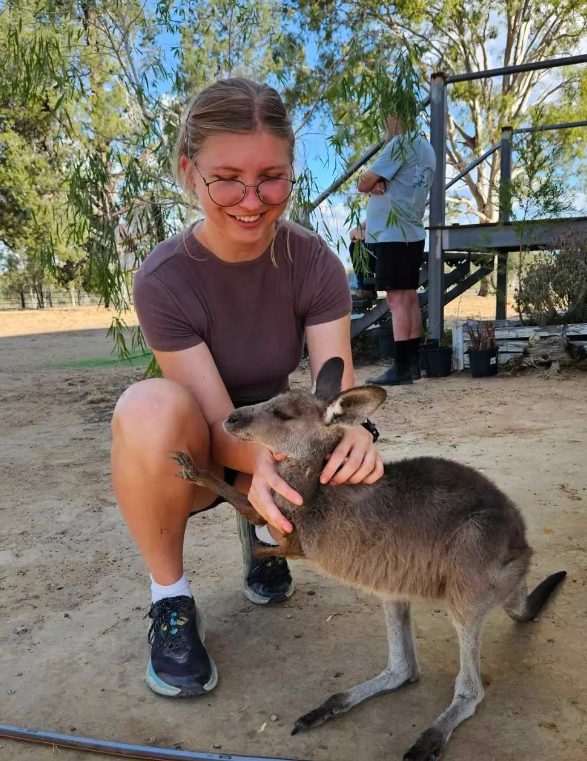

Quantitative ecologist creating ecologist-friendly machine learning pipelines. Science communicator trying to understand the meta of science and academia. I like problem solving with data and making complex things feel simple.

## Current projects
* PhD in standardising machine learning approaches for accelerometer-based animal behavioural classification in small datasets (see my publications [here](https://oakalice.github.io/my_pages/publications))
* 'ECR Ask' interview series where I talk to experienced academics about challenges in science and academia (read my articles [here](https://oakalice.github.io/my_pages/ECRAsks))
* 'Open Questions in Open Science' discussion panel series where I invite expert academics with differing perspectives to discuss controversial topics in academia and metascience (watch recordings [here](https://oakalice.github.io/my_pages/OpenQuestions))
* Getting my first stripe in Brazilian Jiu-Jitsu!

## Get in contact
You can email me at *oakleigh.wilson05[at]gmail.com*. I would love to chat.

  <figure>
    
    <figcaption>Me, with a soon-to-be-collared joey at Roma, outback QLD</figcaption>
  </figure>

